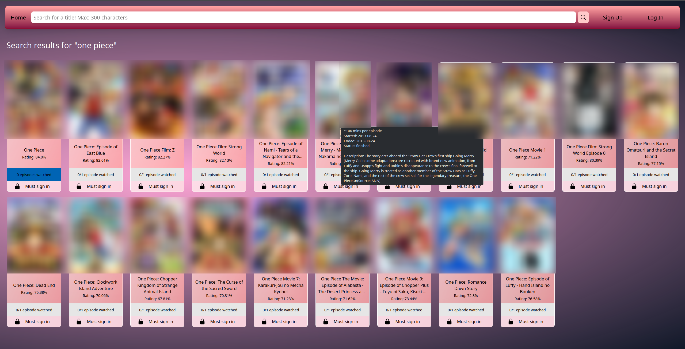
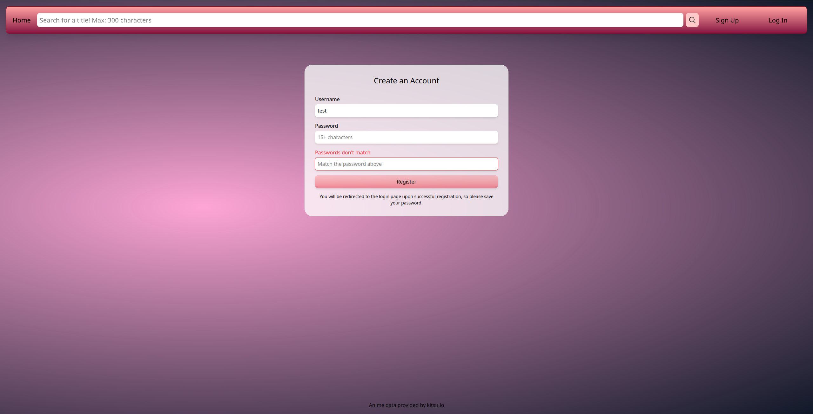
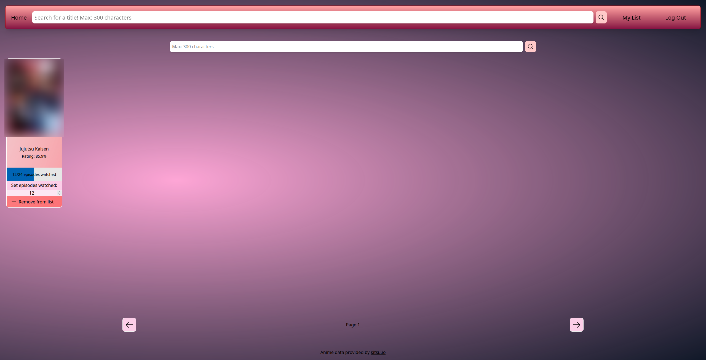

# Secure Socket Anime List Server

Minimalist, security-focused self-hosted HTTPS anime list server using epoll and sockets + template engine using the Lua C API

# Why

Although a simple anime list web app "just works," I wanted to practice and learn systems programming, sockets, building a program from scratch, security-oriented design, etc. However in the future, I would like to bring the main focus to be about securing systems.

As for the template engine, I just couldn't find a C HTML template engine that would suit my needs for features such as math operation or string concatenation, so I had to take matters to my own hands and learn about lexing, parsing, and rendering (basic steps compilers take to compile).

# Screenshots

# Features

- Using Kitsu.io API to search and fetch for metadata of a wide variety of existing anime.
- Hover over any anime entry card to get details such as description, start date, etc
- Basic account authentication (signing up, logging in, logging out) using session cookies (also listed in security features).
- Account holders can add/remove anime to lists stored in a SQLite database.
- Account holders can track/modify episodes watched in their list page.
- Uses TailwindCSS CDN & heroicons for easy-to-manage GUI.
- Template engine uses versatile struct `pair` to store/manage key/value pairs.
    - Ex. Passing a `pair` array to `rendered_template()` to be rendered onto template.

>[!WARNING]
>This project is not meant for production use; only for educational purposes. Web server libraries such as httplib.h handle the risks and issues that may arise from my manual networking/security approach to this project.

>[!CAUTION]
>The template engine uses the C Lua API, thus in the real world, the developer is responsible for reducing the likelihood for attackers to be able to modify/create any HTML templates with unsafe functions embedded as vars. The main purpose of embedding Lua is to allow a developer to return dynamic strings onto the HTML based off of math calculations, string manipulation/concatenation, etc. To support this intended goal, `call_lua_eval()` aims to replace C's `luaL_dostring()` to only allow essential Lua functions (ex. `tonumber()`) to be called in a template.

# Security Features

- HTML sanitization via `sanitized()` imported from template engine &rarr; mitigate malicious Javascript execution from suspicious user input (XSS/Cross-Site Scripting)
- SQLite3 prepared statements &rarr; mitigate SQL injection
- Argon2id password hashing with 32-byte output w/ OpenSSL's cryptographically secure `RAND_bytes()` generated 16-byte salt
- Sessions and IDs generated by OpenSSL `RAND_priv_bytes` and stored in browser cookies only for logged-in users with important flags:
    - HttpOnly &rarr; forbid Javascript from seeing cookie
    - SameSite=Lax &rarr; mitigate CSRF (Cross-Site Request Forging); harder for a malicious site to trick user into performing sensitive POST actions by not sending the cookie
    - Secure &rarr; cookies sent over HTTPS
- IP-based rate limiting using the Token Bucket Algorithm and a resizable array of unique IPs stored in the server's memory &rarr; mitigate request spamming & resource exhaustion (haven't tested w/ multiple clients yet)
- Limiting user input of URLs to 2000 characters, 300 for anime title queries to reduce external Kitsu.io API calls
- Checking for and displaying different HTTP error codes as HTML pages (ex. 404 Not Found page)

# Installation

This was only tested on Arch Linux w/ a kernel supporting epoll, so results may vary. Unlikely to support Windows.
## 1. Install dependencies

### System Requirements
    - Linux
    - gcc
    - git
    - Compatibility with POSIX standards
### Libraries
    - argon2
    - json-c
    - lua 5.5
    - openssl
    - sqlite3
    
## 2. Clone & Navigate to this repository

    git clone <public_repository>
    cd <public_repository>
    
## 3. Generate Self-Signed Certificate & Private Key

    openssl req -x509 -newkey rsa:2048 -nodes \
        -keyout pkey.pem \
        -out chain.pem \
        -days 365

## 4. Compile & Run

    gcc -g -O0 -D_GNU_SOURCE -o server server.c template_engine.c -lssl -lcrypto -ljson-c -llua5.5 -lsqlite3 -largon2
    ./server
    
# Contributing

This is a solo project, thus I will not accept any contributions.

# Credits

- Anime data provided by [kitsu.io](https://kitsu.io)
- Cover art and promotional images are provided through the Kitsu API where available.
- This project does not claim ownership of any anime artwork or associated intellectual property.
- All anime artwork, logos, and trademarks are the property of their respective copyright owners and are used for informational purposes only.

# License

All rights reserved unless stated otherwise. 

This license applies only to the source code in this repository and does not grant any rights to third-party content, including anime metadata, artwork, logos, or trademarks.
